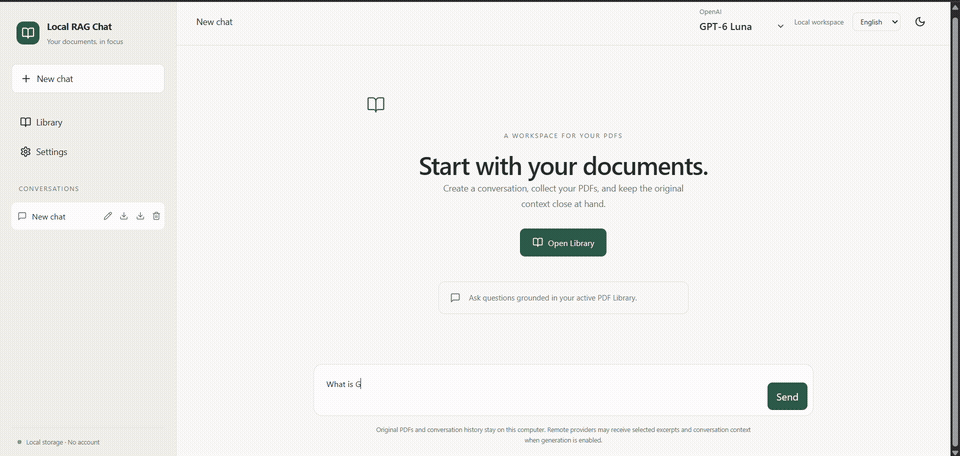

# Ragforge



[](https://github.com/rashidiff/ragforge/actions/workflows/ci.yml)

**Chat with your PDFs. Keep your document library and conversation history on your machine.**

Ragforge is a single-user workspace for conversations grounded in a local PDF library.
It combines local document processing and hybrid search with a configurable LLM
provider, streamed answers, page-level citations, and persistent conversation memory.

The application runs on localhost without Docker, a login, or an external database.
Answer generation uses your selected provider; relevant excerpts and conversation
context may leave your machine. See [Privacy and storage](#privacy-and-storage).

## Features

- **A persistent PDF library** — upload or drag in PDFs, follow indexing progress,
  preview source pages, and reindex or remove documents.
- **Local hybrid retrieval** — multilingual sentence embeddings, FAISS vector search,
  BM25 keyword search, and reciprocal rank fusion.
- **Grounded conversations** — retrieved PDF excerpts inform answers; validated
  citations open the corresponding source page.
- **Configurable providers** — OpenAI, Anthropic, Google Gemini, and optional
  OpenAI Responses-compatible endpoints with explicit capability configuration.
- **Streaming and recovery** — streamed output, Stop, retry, incomplete-answer labels,
  and durable history across restarts.
- **Recursive conversation memory** — per-chat summaries compact completed messages
  in batches of eight while preserving the original archive. Smaller emergency
  batches can recover context budget when needed.
- **A multilingual interface** — English and French, with Unicode document/message support,
  light/dark themes, keyboard controls, and responsive navigation.
- **Portable history** — Markdown and JSON chat exports plus raw-history backups.

Optional enhancements include local Tesseract OCR, multilingual reranking, and
bounded provider tool calls that can search the local library or request excerpts.

## Quick start

### Requirements

- **Python 3.11+** — CI currently checks Python 3.11 on Ubuntu.
- **Node.js 22+** and npm.
- Internet access for dependency and initial embedding-model downloads, and for
  remote LLM requests.
- A provider account and API key to generate answers from indexed documents.
  Enter the key in the application's Settings page.

Windows PowerShell, WSL2, macOS, and Linux startup instructions are provided below.
A successful Ubuntu CI run does not establish compatibility on every platform.

### 1. Get the source

```sh
git clone https://github.com/rashidiff/ragforge.git
cd ragforge
```

### 2. Install dependencies

From the repository root, run these **two commands** on Windows, macOS,
Linux, or WSL2:

```sh
python ragforge.py install
python ragforge.py start
```

If your system names Python `python3`, use `python3` in both commands.
No virtual-environment activation, separate terminals, or global Python package
installation is needed.

The first command creates `.venv`, installs the backend with the `rag` and
`providers` extras (including local PDF processing, embeddings, search, and provider
support), and runs `npm install` in `frontend`. Run it once and again after pulling
dependency changes. Python 3.11+ and Node.js 22+ with npm must already be installed.
An interrupted installation can be retried with the same command.

### 3. Start the workspace

`python ragforge.py start` launches **both the backend and frontend** in the same
terminal and prints their URLs and logs. Open
**[http://127.0.0.1:5173](http://127.0.0.1:5173)** after Vite reports it is ready.
The frontend proxies API requests to the backend at `127.0.0.1:8000`.
Press **Ctrl+C** to stop both servers. If either server exits, the launcher stops
the other and reports the failure. Occupied ports are reported before startup.

For WSL2, keep Python, Node, the checkout, and `.venv` inside the same WSL
distribution. The first PDF indexing job downloads the configured embedding model;
allow time and disk space. Optional Tesseract OCR must be installed separately.

### 4. Ask your first question

1. Open **Settings**, select a provider, enter its API key, and save. Choose the
   model from the **LLM model** dropdown at the top of the chat. You can test the
   connection in Settings using that selection (or the provider default).
2. Open **Library** and upload a text-based PDF. Wait for indexing to finish.
3. Start a chat and ask a question about the document.
4. Open an answer's citation to inspect the supporting page and excerpt.

If the library is empty or no relevant evidence is retrieved, the application
returns an evidence-limited response. Retrieval quality and generated answers
should still be reviewed against the cited sources.

See [model selection and provider catalogs](docs/model-selection.md) for the reviewed
model list, account-access caveats, custom endpoints, and selection behavior.

## Configuration

Defaults work without an `.env` file. To customize non-secret configuration, copy
[`.env.example`](.env.example) to `.env` in the repository root.
**Keep provider API keys out of `.env`, source files, and chat messages.**

| Setting | Default | Purpose |
| --- | --- | --- |
| `RAG_PORT` | `8000` | Local backend port |
| `RAG_DATA_DIR` | `data` | PDFs, history, logs, and index storage |
| `RAG_EMBEDDING_MODEL` | `intfloat/multilingual-e5-small` | Local embedding model |
| `RAG_MAX_UPLOAD_BYTES` | `52428800` | 50 MiB PDF upload limit |
| `RAG_OCR_ENABLED` | `false` | Optional local OCR |
| `RAG_OCR_LANGUAGES` | `eng+fra+fas` | Required Tesseract language packs when OCR is enabled |

Relative storage and prompt paths resolve from the repository root. Changing the
embedding model requires rebuilding the index. OCR also requires a local Tesseract
installation and the configured language packs; it is not enabled by installing
Python dependencies alone.

For a different backend port, set `RAG_PORT` in `.env` or the environment.
The launcher automatically sets the matching frontend proxy. To change the
frontend port, set `RAG_DEV_ORIGIN`, for example `http://127.0.0.1:5174`.
Both servers bind to `127.0.0.1`. Existing `scripts/start.ps1` and
`scripts/start.sh` remain available for backend-only development.

The answer and compaction instructions live in editable UTF-8 Markdown files:
[`prompts/system.md`](prompts/system.md) and
[`prompts/compaction.md`](prompts/compaction.md).
See [PDF processing and recovery](docs/library.md) for model downloads, OCR, and tuning.

## Architecture

```text
PDF upload → validation → page extraction / optional OCR → chunks
                                                         ↓
                                             local embeddings + FAISS / BM25
                                                         ↓
Question + conversation context → hybrid retrieval → selected excerpts
                                                         ↓
                                             configured LLM provider
                                                         ↓
                                       streamed answer + validated citations
```

React and TypeScript provide the interface; Vite builds the frontend. FastAPI and
Pydantic define the backend and public contracts. PDFs are processed with PyMuPDF;
Sentence Transformers provides local embeddings. JSON/JSONL files and immutable
index generations provide persistence without an external database.

| Directory | Contents |
| --- | --- |
| `frontend/` | React interface, component tests, and Playwright scenarios |
| `backend/app/` | API routes, provider adapters, retrieval, and persistence services |
| `backend/tests/` | Automated unit, integration, and failure/recovery tests |
| `prompts/` | Editable answer and compaction prompts |
| `docs/` | Integration contracts, configuration, privacy, and recovery guides |
| `openspec/` | Product specifications, architecture decisions, and implementation tracking |
| `.github/workflows/` | Hosted CI and formatting maintenance |

## Privacy and storage

PDF parsing, chunking, embeddings, indexing, and retrieval run locally. The selected
LLM provider receives instructions, your question, selected PDF excerpts, and
necessary conversation context. Entire PDF files are not uploaded by the provider
adapters. Ragforge is therefore a local document workspace with remote generation,
not a fully offline LLM application.

Provider keys stay in session memory by default. Saving a key to the OS credential
vault is an explicit opt-in. Keys are not returned by the settings API or saved in
browser local storage. Browser storage holds only non-sensitive interface preferences.

The default `data/` directory contains:

- Original PDFs and the library manifest.
- The verbatim `chat_history.jsonl` archive.
- Separate redacted operational logs in `system.log.jsonl`.
- Chat metadata, compaction checkpoints, indexing jobs, and local search generations.

**Local data and exports are not encrypted by the application.** History preserves
what you send, including any sensitive text. Compaction does not rewrite the original
messages. Removing a PDF excludes it from future retrieval; historical citations
can become unavailable. Deleting a chat removes its active history, but previous
backups may still contain it.

Use OS account/disk protections for private documents and backups. If storage is
corrupt, preserve the data directory before recovery rather than replacing files
with empty ones. See [conversation memory and recovery](docs/conversation-memory.md).

## CI and verification

[GitHub Actions](https://github.com/rashidiff/ragforge/actions/workflows/ci.yml)
runs automatically on pushes and pull requests:

| Backend | Frontend |
| --- | --- |
| pytest unit and integration tests | Vitest component and library tests |
| Ruff lint and formatting checks | Mocked Chromium Playwright integration |
| mypy type checking | ESLint and Prettier checks |
| | TypeScript type checking and production build |

CI uses temporary test storage, mocked LLM adapters/transports, and no paid provider
calls or real API keys. Both jobs passed in
[the verified baseline run](https://github.com/rashidiff/ragforge/actions/runs/43252817718).
The badge above shows the current workflow status.

Passing CI establishes the automated checks, including a mocked browser flow.
Live-provider acceptance, real embedding-model behavior, retrieval-quality evaluation,
OCR installations, and the full supported-platform matrix remain separate release
gates. See [CI details](docs/ci.md), [release acceptance](docs/verification.md), and
[the live integration scenario](docs/e2e.md).

## Documentation

- [PDF library, local models, OCR, and index recovery](docs/library.md)
- [Provider capabilities and data boundaries](docs/provider-capabilities.md)
- [Streaming, cancellation, retries, and citations](docs/streaming-contract.md)
- [Recursive memory, context budgets, and durable history](docs/conversation-memory.md)
- [Product specifications and roadmap](openspec/changes/initial-project-documentation/)
